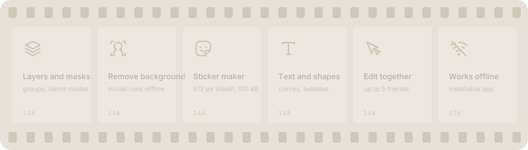
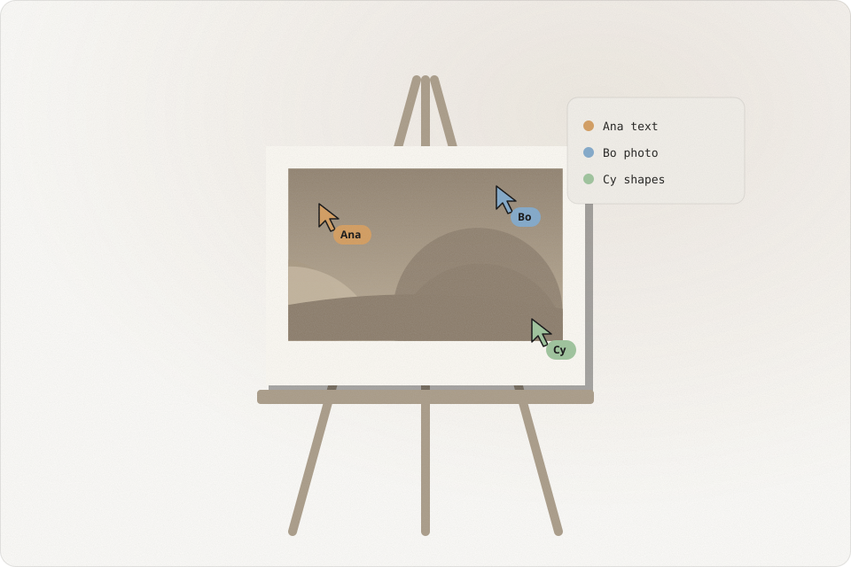

<p align="center">
  <picture>
    <source media="(prefers-color-scheme: dark)" srcset="assets/banner-dark.svg">
    
  </picture>
</p>

<h1 align="center">pixelotter</h1>

<p align="center">A layered photo editor that runs in your browser, works offline and lets friends edit with you, peer to peer.</p>

<p align="center">
  <a href="https://kwy404.github.io/pixelotter/app/"><b>Open the editor</b></a> &middot;
  <a href="https://kwy404.github.io/pixelotter/">Website</a> &middot;
  <a href="i18n/README.pt-BR.md">Português</a>
</p>

<p align="center">
  <picture>
    <source media="(prefers-color-scheme: dark)" srcset="assets/features-dark.svg">
    
  </picture>
</p>

## What it does

- **Workspace:** a menu bar, an options bar, a tool strip, docked panels (layers, channels, properties, adjustments, history, color, swatches, paths, actions, info) and document tabs. A Quick mode keeps one tap edits close for phones.
- **Layers:** groups, blend modes, opacity and fill, layer masks, clipping, adjustment and fill layers, layer styles.
- **Selections:** marquee, ellipse, lasso, polygon lasso, magic wand and quick select, with feather, expand, contract, refine and channels as selections.
- **Tools:** brush, pencil, eraser, clone, heal, dodge, burn, sponge, smudge, gradient, bucket, text, shapes, pen, crop and free transform.
- **Filters:** levels, curves and the other adjustments, blur, sharpen, noise, distort and stylize groups, liquify, content aware fill and a cutout model that runs on your device.
- **History:** unlimited undo, a history panel, autosave in this browser and recovery.
- **Files:** layered PSD and PSB in and out, TIFF (with CMYK), PNG and APNG, JPEG, WebP and AVIF where the browser can encode them, GIF, BMP, ICO, TGA, PDF, plus the `.pxo` project file. HDR, EXR, Netpbm and camera raw previews open read only.
- **Print:** an approximate CMYK soft proof, a gamut warning and CMYK TIFF export.
- **Together:** invite up to five friends with six words, a QR code or a link. Everyone edits the same document with live cursors and per layer locks, and the room has chat, voice with noise suppression, cameras and screen sharing.
- **Right click everywhere:** a context menu on the canvas, layers, chat messages and people, also by long press and the Menu key.

<p align="center">
  <picture>
    <source media="(prefers-color-scheme: dark)" srcset="assets/illustrations/together-dark.svg">
    
  </picture>
</p>

## Inviting friends

Click **Edit together**. The room shows six words, a QR code and an invite link with a Copy button. All three carry the same words. The link keeps them after the `#` sign (`app/#join=word-word-word-word-word-word`), which browsers never send to any server, and the app clears it from the address bar as soon as it reads it.

The words derive a key that seals the connection handshake while it passes through public MQTT relays, so the relays only see encrypted data. After that, everything goes straight between the browsers over WebRTC, encrypted with DTLS. Each connection shows six safety words on both screens; when they match, nobody sits in the middle.

## Honest limits

- CMYK is an approximation from a generic coated press model. There is no ICC color engine, so it is a preview, not a proof for your print shop.
- PSD smart objects, vector shapes and live type made in other apps open as pixels. 32 bit PSD files are not supported.
- AVIF and WebP export depend on the browser. The app says when a format cannot be encoded.
- The cutout model (U2-Netp, Apache 2.0) and its runtime download once, about 16 MB, then work offline.
- Peer to peer can fail on very strict networks. You can add your own TURN server in Settings. Screen sharing needs a desktop browser, and voice and video run in a full mesh, so many cameras need a good connection.

## Develop

```bash
npm install
npm run serve        # http://localhost:8080/pixelotter/
npm test             # unit tests
npm run lint
npm run check:rules
npm run test:e2e     # the editor in two headless browsers
npm run test:live    # a room with four headless browsers and fake media devices
```

`src/` holds the shared modules; `npm run build:app` copies them to `docs/app/lib/` and refreshes the offline cache list. The site in `docs/` is static and runs on GitHub Pages.

## License

[MIT](LICENSE), 2026, Alexandre Kohler. Made by [Alexandre Kohler](https://github.com/kwy404).
